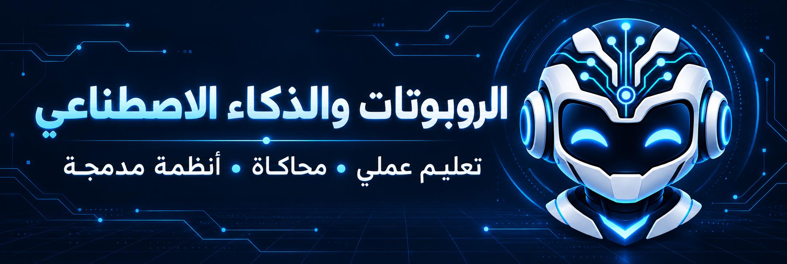

  

<h1 align="center">نبني المعرفة بالتجربة</h1>

مساحة تعليمية للروبوتات والذكاء الاصطناعي، تجمع شرح المفاهيم وتمارين البرمجة والمحاكاة والتحكم بالأنظمة المدمجة.

  <strong>شرح بالعربية والإنجليزية</strong> · <strong>تمارين منظمة</strong> · <strong>توثيق خطوات التشغيل والنتائج</strong>

---

<strong><a href="https://tcti-robotics-ai.github.io/robot-operating-systems-204/">تصفح موقع المقرر والعروض الأسبوعية ←</a></strong>

## المقرر الذي نعمل عليه

### أنظمة تشغيل الروبوتات · ٢٠٤ روبوت

محتوى تعليمي منظم في ست وحدات، مع عروض أسبوعية وأدلة للتمارين. يبدأ من أساسيات روس وإعداد البيئة، ويمتد إلى محاكاة الروبوتات والمحادثة والصوت وربط اللوحات المدمجة.

  <strong>٦ وحدات تعليمية</strong> &nbsp; · &nbsp; <strong>١٦ عرضًا أسبوعيًا</strong> &nbsp; · &nbsp; <strong>٤ مسارات لربط اللوحات</strong>

| الوحدة | مجال التعلم |
| --- | --- |
| أساسيات روس | العقد والمواضيع والخدمات وتبادل البيانات |
| التثبيت وإعداد البيئة | لينكس وإعداد الأدوات والاعتماديات |
| محاكاة الروبوت المتنقل | النمذجة والحركة والتحكم |
| محاكاة الذراع الروبوتية | المفاصل والذراع والقابض |
| المحادثة والصوت | التفاعل الصوتي وتحويل الأوامر إلى إجراءات |
| الأنظمة المدمجة | الربط مع أردوينو ومتحكمات إس تي إم والراسبيري وأودرويد |

**[مستودع المقرر](https://github.com/TCTI-Robotics-AI/robot-operating-systems-204)** &nbsp; · &nbsp; **[فهرس التمارين](https://github.com/TCTI-Robotics-AI/robot-operating-systems-204/blob/main/course/exercises-index.md)** &nbsp; · &nbsp; **[العروض الأسبوعية](https://github.com/TCTI-Robotics-AI/robot-operating-systems-204/tree/main/PPT)**

> محتوى المقرر متاح للجميع. ابدأ بفهرس التمارين أو تصفح العروض الأسبوعية من الروابط أعلاه.

## أدوات التعلم والتطبيق

**لينكس وأوبونتو** لإعداد البيئة · **روس** لربط مكونات الروبوت · **جازيبو وآر فيز** للمحاكاة والعرض · **بايثون** لبرمجة التمارين · **راسبيري باي** لتطبيقات الأنظمة المدمجة.

## تطبيقات قيد التطوير

- **التحكم المنزلي بالصوت:** تحويل الأوامر المنطوقة إلى إجراءات على الأجهزة.
- **المحادثة والذكاء الاصطناعي:** استكشاف التفاعل اللغوي ضمن تطبيقات الروبوتات.
- **الربط بين اللوحات:** تمارين لربط الحاسب المضيف بالمتحكمات والأجهزة المدمجة.

نوضح في توثيق كل تمرين متطلباته وخطواته وحالة اختباره. يجري تطوير التطبيقات والتحقق منها تدريجيًا، وتوثق نتائج المحاكاة واختبارات الأجهزة كلٌّ على حدة.

---

<strong>نفهم الفكرة، نكتب الكود، ونوثّق النتيجة.</strong>

